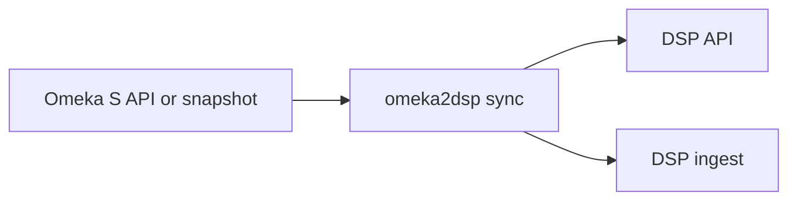

# omeka2dsp

omeka2dsp copies the research data of [Stadt.Geschichte.Basel (SGB)](https://stadtgeschichtebasel.ch/) from Omeka S to the [DaSCH Service Platform (DSP)](https://www.dasch.swiss/) for long-term preservation.
It creates new records, changes records that are different, and uploads the media files.

[](LICENSE-AGPL.md)
[](https://github.com/Stadt-Geschichte-Basel/omeka2dsp/issues)



## Documentation

- [Architecture](docs/architecture/index.qmd): modules, sync flow, and safety rules.
- [Data model](docs/datamodel/index.qmd): DSP classes, lists, and the mapping table.

## Setup

You need [uv](https://docs.astral.sh/uv/). uv installs Python 3.15 when it is not on your computer.

```bash
git clone https://github.com/Stadt-Geschichte-Basel/omeka2dsp.git
cd omeka2dsp
uv sync --extra dev
cp example.env .env
```

Then write your values into `.env`.

## Settings

omeka2dsp reads `.env` and the environment.
If a required value is missing, the command stops before it connects to a server.

| Variable             | Required | Default                       |
| -------------------- | -------- | ----------------------------- |
| `API_HOST`           | yes      |                               |
| `INGEST_HOST`        | yes      |                               |
| `PROJECT_SHORT_CODE` | yes      |                               |
| `DSP_USER`           | yes      |                               |
| `DSP_PWD`            | yes      |                               |
| `ONTOLOGY_NAME`      | no       | `SGB`                         |
| `ITEM_SET_ID`        | no       | `10780`                       |
| `OMEKA_API_URL`      | no       | `https://omeka.unibe.ch/api/` |
| `KEY_IDENTITY`       | no       |                               |
| `KEY_CREDENTIAL`     | no       |                               |
| `HTTP_TIMEOUT`       | no       | `30` (seconds)                |

## Usage

```bash
# Check the payloads and log the planned changes. Write nothing to DSP.
uv run omeka2dsp sync --dry-run --ids-file test_ids.txt

# Sync all items of the item set.
uv run omeka2dsp sync

# Sync two items.
uv run omeka2dsp sync --id abb13025 --id abb14375

# Sync 2 random items.
uv run omeka2dsp sync --sample 2
```

To upload clean data, make a snapshot with [sgb-data-validator](https://github.com/Stadt-Geschichte-Basel/sgb-data-validator) first (`sgb download`, `sgb transform`).
Then give the snapshot directory to `sync`:

```bash
uv run omeka2dsp sync --snapshot SNAPSHOT_DIR --ids-file test_ids.txt --dry-run
uv run omeka2dsp sync --snapshot SNAPSHOT_DIR --ids-file test_ids.txt
```

After the upload, a second dry run must log no changes.

Each `sync` run writes its log to `data_2_dasch.log` and replaces the old log.

| Option            | Effect                                                             |
| ----------------- | ------------------------------------------------------------------ |
| `--snapshot DIR`  | Read items and media from a snapshot directory.                    |
| `--id ID`         | Select the item with this `dcterms:identifier`. You can repeat it. |
| `--ids-file FILE` | Select the identifiers in a file, one on each line.                |
| `--sample N`      | Select N random items.                                             |
| `--dry-run`       | Check the payloads and log the changes. Write nothing to DSP.      |
| `--recreate ID`   | Erase a media record in the wrong class and create it again.       |

`omeka2dsp add-text-class` prints the request that adds the `Text` class to the DSP ontology.
Add `--apply` to send the request. This needs a DSP user with project-admin rights.

## Checks

```bash
uv run --locked --extra dev pytest test/
uv run --locked --extra dev ruff check src test
uv run --locked --extra dev ruff format --check src test
uv run --locked --extra dev ty check src test
```

CI runs the same four checks.

## Support and contributions

Use [GitHub Issues](https://github.com/Stadt-Geschichte-Basel/omeka2dsp/issues) for bugs, bad data, and requests.
Read [CONTRIBUTING.md](CONTRIBUTING.md) before you open a pull request.
Report security problems as [SECURITY.md](SECURITY.md) tells you.

## Authors

- **Stadt.Geschichte.Basel**: [Stadt-Geschichte-Basel](https://github.com/Stadt-Geschichte-Basel)
- **Nico Görlich**: initial scripts, [koilebeit](https://github.com/koilebeit)

## License

- Code: GNU Affero General Public License v3.0. See [LICENSE-AGPL.md](LICENSE-AGPL.md).
- Data: Creative Commons Attribution 4.0 International. See [LICENSE-CCBY.md](LICENSE-CCBY.md).
